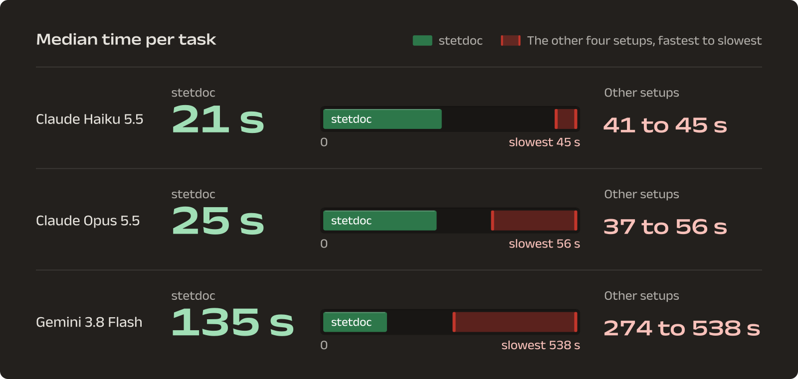

<p>
<picture>
  <source media="(prefers-color-scheme: dark) and (max-width: 600px)" srcset="https://raw.githubusercontent.com/clauseo-ai/stetdoc/main/packaging/brand/readme/banner-night-narrow.svg">
  <source media="(max-width: 600px)" srcset="https://raw.githubusercontent.com/clauseo-ai/stetdoc/main/packaging/brand/readme/banner-day-narrow.svg">
  <source media="(prefers-color-scheme: dark)" srcset="https://raw.githubusercontent.com/clauseo-ai/stetdoc/main/packaging/brand/readme/banner-night.svg">
  
</picture>
</p>

stetdoc is how AI agents work in Word. Every change your agent makes lands in Word as a tracked change with its name on
it, and everything it didn't touch comes back exactly as it was.

```sh
brew install \
  clauseo-ai/tap/stetdoc
stetdoc init
```

`stetdoc init` installs the skill for the agents you pick, or for every agent it finds when there's no terminal. Without Homebrew, run `uv tool install stetdoc`, or pick another
of the [channels below](#install-stetdoc).

**[Read the docs](https://stetdoc.clauseo.chat/docs)** · [Quickstart](docs/quickstart.md) · [Changelog](CHANGELOG.md) ·
Free and open source, MIT or Apache-2.0

```
$ stetdoc replace msa.docx 'due within thirty (30) days' 'due within forty-five (45) days'
replace "due within thirty (30) days" with "due within forty-five (45) days": once, at p145 (clause 11.1)
applied 1 operation, tracked as Claude 2026-11-02T07:44:07Z. base 96c462d4a556723b:0:96c462d4a556723b
0 replace p145: deletion #54, insertion #55
p145 {style "First Paragraph"} 11.1 Payment … shall be due within {--thirty (30)--}{#54 C}{++forty-five (45)++}{#55 C} days …
validated 1 unit: no problems, and this file needs no separate check.
wrote msa.edited.docx
msa.docx is unchanged. Run the next edit on msa.edited.docx to build on this one, …
```

<sub>stetdoc 0.9.1 on a supply agreement from Harvey LAB, with the long lines cut short. `{--…--}` is the deletion and
`{++…++}` the insertion, each a Word revision by Claude.</sub>

## Word found unreadable content.

Every agent that edits a .docx's XML gets this message from Word sooner or later. Word splits a sentence across many runs and
stores tracked changes as XML structure. It refuses a file whose elements fall out of schema order. One slip in the XML
and the document won't open.

stetdoc checks every edit against the schema and Word's own rules before it writes a byte. A batch of edits applies
in full or not at all. Bad input, a hostile file included, fails with a stable error code. stetdoc never panics,
hangs or touches the network.

## Done first, on every model.

We gave agents eight contract-editing tasks five ways: with stetdoc, with no plugin, with Anthropic's docx skill, with
Anthropic's legal plugin and with Adeu. Then we opened every file they wrote in Word. The agents using stetdoc finished
first on all three models.

<p>
<picture>
  <source media="(prefers-color-scheme: dark) and (max-width: 767px)" srcset="https://raw.githubusercontent.com/clauseo-ai/stetdoc/main/packaging/brand/readme/bench-night-narrow.svg">
  <source media="(max-width: 767px)" srcset="https://raw.githubusercontent.com/clauseo-ai/stetdoc/main/packaging/brand/readme/bench-day-narrow.svg">
  <source media="(prefers-color-scheme: dark)" srcset="https://raw.githubusercontent.com/clauseo-ai/stetdoc/main/packaging/brand/readme/bench-night.svg">
  
</picture>
</p>

- **0 of 118** stetdoc runs wrote a file Word offered to repair.
- **6 of 6** long Harvey LAB markups came out correct in full, on every model.
- **1 ms** from launch to a ready MCP server.

<sub>docx-agent-bench, 639 runs in Claude Code 2.1.311 and Antigravity CLI 1.4.8. Five runs per task, medians per run,
and every file opened in Microsoft Word for Mac 16.114.3.</sub>

## Open, save, same bytes.

Run a document through stetdoc without editing it and you get the identical file back, byte for byte. Edit one clause
and only that clause's elements change. Styles, numbering, comments, other people's tracked changes and macros stay
where their authors left them.

```
$ stetdoc unpack msa.docx && stetdoc pack msa.stet -o roundtrip.docx
$ cmp msa.docx roundtrip.docx && echo identical
identical
```

We test this every night on about 48,600 documents from 58 public sources. Every build also puts 306 of them through
50 random edit batches each. [`FIDELITY.md`](FIDELITY.md) says, feature by feature, what stetdoc keeps exactly, what it
normalizes, what it shows read-only and what it leaves out.

## It knows where 11.1 is.

Lawyers cite clauses by number. Word works those numbers out when it draws the page, so they appear nowhere in the
file. stetdoc computes them, and a search hands your agent the clause, a stable paragraph ref and the exact text.

```
$ stetdoc view msa.docx --find 'thirty' --find 'governing law'
p81 {§3.3} …be submitted to the Seller not less than thirty (30) days prior to the first day of the… {~ "thirty" 2}
p145 {§11.1} …each Shipment of Products shall be due within thirty (30) days from the date… {~ "thirty" 1}
p268 22.7 Governing Law of the Arbitration Agreement. This arbitration agreement contained in this… {~ "governing law" 1}
{position: p81..p466 of find "thirty" (13), "governing law" (3): 16 matches in 15 blocks (15 of 15 blocks)}
```

<sub>Three of the 16 hits, with the long lines cut short. This block leaves out the other 13 and the clause headings
stetdoc prints above them.</sub>

## Twelve matches is not one.

`replace` matches text the way it reads, across bold, italics and run breaks. When the text appears more than once,
stetdoc writes nothing and lists every match with its clause. Missing text gets the same refusal. stetdoc also refuses
an edit aimed at a paragraph that changed after the agent read it, so a change never lands in the wrong place.

```
$ stetdoc replace msa.docx 'thirty (30) days' 'forty-five (45) days'
error[ambiguous_match]: "thirty (30) days" is in the document 12 times, and it must be there once:
  p81 (clause 3.3) …d to the Seller not less than [thirty (30) days] prior to the first day of the…
  p145 (clause 11.1) … Products shall be due within [thirty (30) days] from the date of the Bill of …
next: Nothing was applied, so retry at once, with no dry run: to change every one, pass --all; to pick one place, …
```

<sub>Two of the 12 places, with the long last line cut short. stetdoc lists all 12.</sub>

## Hands off the XML.

stetdoc gives your agent the document as text, with a ref on every paragraph and a number on every clause. The zip and
its XML stay with stetdoc. In Claude Code, the plugin adds a hook that stops Claude from unzipping a .docx, scripting it
with python-docx or rewriting its XML. The only way into the file is the one stetdoc checks.

In Claude Code 2.1.275 or later, one line installs the plugin. It carries the skill and the hook. The binary must still
be on the PATH, because Claude Code runs the command rather than MCP.

```
/plugin install stetdoc --marketplace clauseo-ai/stetdoc
```

## One install for every agent you run.

`stetdoc init` installs the skill for the agents you pick, or for the ones it detects. It knows Claude Code, Codex,
Cursor, OpenCode, OpenClaw, Hermes Agent, Grok Build, cmx2, Antigravity CLI, GitHub Copilot CLI, Amp and Factory. It
still installs for Gemini CLI, which Google retired in favour of Antigravity CLI.

```sh
stetdoc init --project   # in this project, plus a short block in AGENTS.md
stetdoc init --list      # what is installed, and where
stetdoc init --remove    # take it out again
stetdoc skills get core  # the full skill, embedded in the binary
```

Agents that take tools instead of a shell get the same commands over the Model Context Protocol from `stetdoc mcp`.
`stetdoc init --mcp` prints how to register it with each agent. Install the skill with the server. Without the skill, an
agent whose server fails to start falls back to unzipping the .docx and editing its XML. [Use stetdoc with your agent](docs/agents.md) has the setup
for each one. To serve `stetdoc mcp` to cloud apps, with auth and TLS, see
[Self-hosting the MCP server](docs/self-hosting-mcp.md).

## Install stetdoc

Pick any channel. Every one installs the same binary.

```sh
# Homebrew, macOS and Linux
brew install clauseo-ai/tap/stetdoc

# uv or pipx, Windows too
uv tool install stetdoc
pipx install stetdoc

# npm
npm install -g stetdoc

# Install script, macOS and Linux
curl -fsSL https://raw.githubusercontent.com/clauseo-ai/stetdoc/main/packaging/install.sh | sh

# Cargo, from source
cargo install stetdoc --locked
```

The uv and pipx wheel holds the native binary, so no Python runs after the install. The install script checks the SHA-256
and installs to `~/.local/bin`. npm swaps its Node launcher for the binary when install scripts run.

An agent can run stetdoc dozens of times in one task. Homebrew, uv, pipx and the install script put the binary itself
on your PATH, so each call starts in about 5 ms. Through npx, every call starts Node and npm first, which costs a tenth
of a second or more. Keep `npx stetdoc mcp` for the MCP server, which starts once per session. `uvx stetdoc` runs
stetdoc once without installing it. [Install](docs/install.md) covers Windows, updating, uninstalling and pinning a
version.

## The commands

```sh
# Every revision has an author. Set it here, or save yours once with stetdoc init.
export STETDOC_AUTHOR="Jane Doe"
# Each hit shows its ref, its clause and the exact text.
stetdoc view contract.docx --find 'net 30' --find 'governing law'
# Writes contract.edited.docx. The old text must appear once, or nothing changes.
stetdoc replace contract.docx 'net 30' 'net 45'
stetdoc comment contract.edited.docx 'Liability Cap' 'Is this mutual?' --in-place
# A redline of any two versions.
stetdoc compare old.docx new.docx -o redline.docx
```

An edit writes `NAME.edited.docx` beside the input, then `NAME.edited-2.docx`, and never overwrites. `-o FILE` names
the output and `--in-place` writes back. Receipts and views name the tracked changes other people made, so the agent
can report them.

For longer work, unpack a working copy and edit its readable files with any tool, string replacement and `apply_patch`
included:

```sh
stetdoc unpack contract.docx        # writes contract.stet/
$EDITOR contract.stet/document.md   # edit the text after each ref
stetdoc check contract.stet         # the redline pack will write, validated
stetdoc pack contract.stet          # writes contract.edited.docx with real tracked changes
```

Inserting paragraphs, formatting, and accepting or rejecting revisions go to `stetdoc edit` as a batch of
[operations](docs/reference/operations.md). [How stetdoc works](docs/concepts.md) explains working copies, refs, base
tokens and receipts. The [CLI reference](docs/reference/cli.md) lists every command and flag, such as `--clause`,
`--range`, `--all` and `--manual`, with examples that run as tests.

## Build on stetdoc

The engine is a Rust library, `stetdoc-core`, built around one handle:

```rust
let mut doc = Document::open(bytes, &OpenOptions::default())?;
let view = doc.view(&ViewSpec::default())?;
// Tracked by default.
let receipt = doc.edit(Edit::ops(batch, stamp))?;
// Unedited, it returns the input bytes.
let saved = doc.save()?;
```

Node and Bun use it through the npm package `@clauseo/stetdoc`, with TypeScript types generated from the engine's
definitions. Its `textEditor` is the backend of Claude's text editor tool, as the crate `stetdoc-editor` is in Rust.
Errors carry a stable code, a message and a `next` hint, and the npm package throws them as `StetdocError`.

[Build on stetdoc](docs/build-on-stetdoc.md) compares the crate, the npm package, the CLI and MCP for products. The npm
package has its own guide, [`crates/stetdoc-napi/npm/README.md`](crates/stetdoc-napi/npm/README.md), and the
[error reference](docs/reference/errors.md) lists every code.

## Repository

- [`ARCHITECTURE.md`](ARCHITECTURE.md): the map for anyone new to the code
- [`GLOSSARY.md`](GLOSSARY.md): what each domain term means
- [`docs/decisions/`](docs/decisions/0001-core-interface.md) and [`docs/design/`](docs/design/revisions.md): the
  decision records and the design notes behind each module
- [`AGENTS.md`](AGENTS.md) and [`CONTRIBUTING.md`](CONTRIBUTING.md): the commands, the rules the checks enforce, and
  how to make a change and get it reviewed
- [`SECURITY.md`](SECURITY.md): how to report a vulnerability, and how we test hostile input
- [`CODE_OF_CONDUCT.md`](CODE_OF_CONDUCT.md): how we expect people to treat each other here

Build and verify with `cargo xtask check`. Besides formatting, lints and unit tests, it runs the laws on the curated
corpus of 306 documents. Every unedited round trip must come back byte-identical. On each document, 50 seeded random
edit batches must keep the [laws](GLOSSARY.md#quality): they change only what they edit, the edits stick, accepting or
rejecting them restores the expected text, and the file stays valid. The full corpora run nightly in CI. Each fuzz target runs for at least 24 hours before a
release.

## Licence

You can use stetdoc under either the [Apache License, Version 2.0](LICENSE-APACHE) or the [MIT licence](LICENSE-MIT), at
your option. See [`NOTICE`](NOTICE).

<sub>Stet is the proofreader's mark for "let it stand". It goes under a word that was struck out by mistake, and the
word stays. stetdoc is open source, from [Clauseo](https://www.clauseo.chat).</sub>
